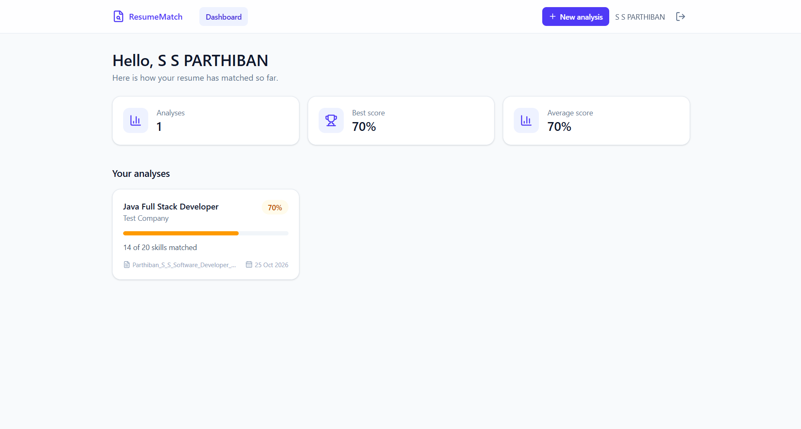
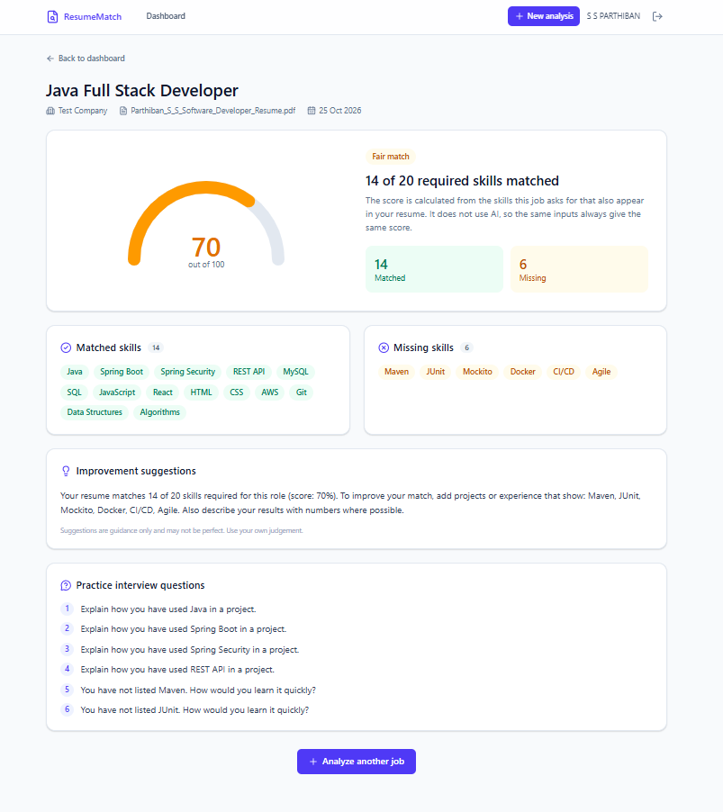

# Resume Analyzer and Job Matcher

A full-stack web app that compares a resume against a job description and produces an explainable match report: a score, matched skills, missing skills, improvement suggestions and practice interview questions.

The score is calculated by deterministic Java code, not by an AI model, so the same inputs always give the same result.

## Screenshots

| Dashboard | Result |
|---|---|
|  |  |

## Features

- Register and log in with JWT authentication (BCrypt-hashed passwords)
- Upload a resume as PDF or DOCX, with text extraction
- Dictionary-based skill extraction with alternate spellings (for example "springboot" counts as Spring Boot)
- Match score, matched skills and missing skills for any job description
- Saved analysis history per user, with a dashboard and detailed result page
- Per-user data isolation: users can only open their own resumes and results
- Consistent JSON error responses and input validation
- Responsive React interface

## Tech stack

**Backend:** Java 21, Spring Boot, Spring Security, JWT, Spring Data JPA, MySQL, Apache PDFBox, Apache POI, JUnit
**Frontend:** React, Vite, Tailwind CSS, Axios, React Router

## How it works

1. The user uploads a resume. The backend extracts its text and stores it in MySQL.
2. The user pastes a job description.
3. The matching engine finds known skills in both texts using a dictionary (`skills.txt`) and word-boundary rules, so "Java" is not found inside "JavaScript".
4. Score = matched skills / skills required by the job x 100.
5. The result is saved and shown in the React app.

## API overview

| Method | Endpoint | Description |
|---|---|---|
| POST | `/api/auth/register` | Create an account |
| POST | `/api/auth/login` | Log in and receive a JWT |
| POST | `/api/resumes` | Upload a resume (PDF or DOCX, max 5 MB) |
| GET | `/api/resumes` | List your resumes |
| POST | `/api/analyses` | Run an analysis |
| GET | `/api/analyses` | List your analyses |
| GET | `/api/analyses/{id}` | Get one analysis |

All endpoints except `/api/auth/**` require the header `Authorization: Bearer <token>`.

## Running locally

**Requirements:** Java 21, Maven, MySQL 8, Node.js

1. Create the database:
   ```sql
   CREATE DATABASE resume_analyzer;
   ```
2. Set environment variables:
    - `DB_PASSWORD`: your MySQL root password
    - `JWT_SECRET`: a random string of at least 32 characters
3. Start the backend:
   ```
   ./mvnw spring-boot:run
   ```
   It runs on `http://localhost:8080`.
4. Start the frontend (see the frontend repository):
   ```
   npm install
   npm run dev
   ```
   It runs on `http://localhost:5173`.

## Tests

```
./mvnw test
```

Unit tests cover the skill extractor (including edge cases such as Java vs JavaScript and SQL vs MySQL) and the scoring logic (perfect match, partial match, no overlap, rounding and rejection of job descriptions with no known skills).

## Current limitations

- Skill detection only finds skills listed in `skills.txt`, and treats every required skill as equally important.
- Scanned (image-only) resumes are not supported, because there is no OCR.
- The AI feedback and interview questions currently come from a template-based placeholder. The code is structured behind an `AiFeedbackService` interface so a real LLM can be plugged in.

## Planned improvements

- Real LLM integration for feedback and interview questions, with output validation, timeouts and fallbacks
- Weighted skills (required vs nice to have)
- Deployment with a live demo